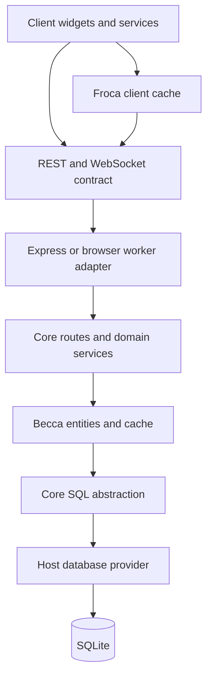

# Architecture
Trilium is a TypeScript monorepo with a shared frontend and a portable backend core. Server, desktop, standalone browser and mobile hosts provide the platform services around that core.

## Runtime boundaries

*   `apps/client` contains the Preact frontend, legacy widgets and the Froca client cache. It communicates with the backend through REST and WebSocket messages. Shared wire types live in `packages/commons`; the client does not import `packages/trilium-core`.
*   `packages/trilium-core` owns Becca entities, domain services, synchronization, migrations, SQL abstractions and shared API handlers. It runs in Node.js and in a browser worker. Node built-ins belong in host providers.
*   `apps/server` hosts core in Node.js with Express, WebSockets and better-sqlite3. It owns HTTP middleware, ETAPI, filesystem access and Node-specific providers.
*   `apps/desktop` hosts the server and client in Electron, with native integrations.
*   `apps/standalone` hosts core in a browser Web Worker with SQLite WASM and OPFS. Its router and messaging providers adapt the shared API to the worker.
*   `apps/mobile` is a Capacitor shell around standalone.



Entity mutations use the Becca owner so cache updates, entity changes and synchronization agree. Reordering and local expansion have specialized entity methods that preserve their timestamp and notification contracts. SQL infrastructure, migrations and sync ingestion are specialized persistence paths; route handlers do not hand-patch entity tables and cache state independently.

## Deployment modes

| Host | Backend runtime | Database provider | Frontend |
| --- | --- | --- | --- |
| Server | Node.js and Express | better-sqlite3 | Browser |
| Desktop | Electron main process and server | better-sqlite3 | Electron renderer |
| Standalone | Browser Web Worker | SQLite WASM and OPFS | Browser |
| Mobile | Standalone in Capacitor | SQLite WASM and OPFS | Capacitor WebView |

Each document belongs to one user. Devices synchronize independent databases. The sync mutex coordinates operations within one process; it does not coordinate independently cached processes sharing a writable file. SQLite supplies database writer locking.

## Workspace dependencies

Runnable entry points and tools live under `apps/*`; libraries live under `packages/*`, as declared by `pnpm-workspace.yaml`. See [Project Structure](Project%20Structure.md) for the inventory.

```
client -> commons, editor and rendering packages
server -> trilium-core, commons, client assets
standalone -> trilium-core, commons, client assets
desktop -> server and client assets
mobile -> standalone
trilium-core -> commons and portable dependencies
```

## Architecture invariant registry

This registry records the active boundaries from `CLAUDE.md` and the current interface/schema owners. Changes to a boundary must update its implementation, consumers, tests and this record together.

| ID | Invariant | Owner and verification |
| --- | --- | --- |
| TRI-ARCH-001 | The frontend reaches core through REST/WebSocket, with shared types in commons. | `packages/commons/src/lib/ws_api.ts`; client WS and Froca specs. |
| TRI-ARCH-002 | Core supports Node and browser workers; host providers own Node capabilities. | `packages/trilium-core/src/services/platform.ts`; core specs run on server and standalone. |
| TRI-DATA-001 | A branch ID cannot overwrite another parent/child pair. | `becca/entities/bbranch.ts`; `audit_integrity.spec.ts`. |
| TRI-DATA-002 | New note IDs cannot overwrite existing notes or tombstones. | `services/notes.ts`; explicit undelete restores deleted identities. |
| TRI-DATA-003 | Ordinary saves cannot revive persisted note tombstones. | `becca/entities/bnote.ts`; lifecycle and undelete specs. |
| TRI-DATA-004 | Entity-table writes belong to entities or documented persistence infrastructure. | Becca entities, sync ingestion, erase and migration services. |
| TRI-TXN-001 | Rollback restores database-derived cache state and the entity-change cursor. | `becca/becca_loader.ts`; host rollback hooks and rollback regression. |
| TRI-TXN-002 | Task success notifications follow the outer commit. | SQL `afterCommit`; `audit_transactions.spec.ts`. |
| TRI-SAFE-001 | Safe import validates attributes from metadata and front matter alike. | `services/import/utils.ts`; import boundary specs. |
| TRI-SCHEMA-001 | Fresh schema and migration results agree; a failed migration cannot advance its marker. | `assets/schema.sql`, `migrations/migrations.ts`; migration recovery specs. |

Paths in the registry without a package prefix are relative to `packages/trilium-core/src`.

## Decision record

These entries document existing architecture, rather than introduce new boundaries. They are recorded on 2026-10-16 from `CLAUDE.md` and the provider contracts above.

*   **TRI-DEC-001 — Portable backend core:** server, desktop, standalone and mobile share domain behavior; hosts inject database, crypto, archive, request, logging and platform services.
*   **TRI-DEC-002 — Cache ownership:** Becca owns backend entity lifecycle and Froca mirrors it in the client. Shared wire contracts belong in commons.
*   **TRI-DEC-003 — Compatible branch identities:** existing deterministic branch IDs remain valid; ambiguous parent/child pairs fail explicitly before persistence. A new identity format requires a coordinated migration and peer-compatibility plan.

The remaining Becca/service import cycles and import-time server configuration initialization require separate lifecycle refactors. This registry does not claim that they have been removed.

## Security summary

### Encryption System

**Per-Note Encryption:**

*   Notes can be individually protected
*   AES-128-CBC encryption for encrypted notes.
*   Separate protected session management

**Protected Session:**

*   Time-limited access to protected notes
*   Automatic timeout
*   Re-authentication required
*   Frontend: `protected_session.ts`
*   Backend: `protected_session.ts`

### Authentication

**Password Auth:**

*   PBKDF2 key derivation
*   Salt per installation
*   Hash verification

**OpenID Connect:**

*   External identity provider support
*   OAuth 2.0 flow
*   Configurable providers

**TOTP (2FA):**

*   Time-based one-time passwords
*   QR code setup
*   Backup codes

### Authorization

**Single-User Model:**

*   Desktop: single user (owner)
*   Server: single user per installation

**Share Notes:**

*   Public access without authentication
*   Separate Shaca cache
*   Read-only access

### CSRF Protection

**CSRF Tokens:**

*   Required for state-changing operations
*   Token in header or cookie
*   Validation middleware

### Input Sanitization

**XSS Prevention:**

*   DOMPurify for HTML sanitization
*   CKEditor content filtering
*   CSP headers

**SQL Injection:**

*   Parameterized queries only
*   Better-sqlite3 prepared statements
*   No string concatenation in SQL

### Dependency Security

**Vulnerability Scanning:**

*   Renovate bot for updates
*   npm audit integration
*   Override vulnerable sub-dependencies